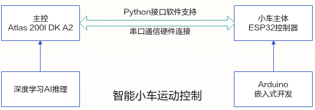
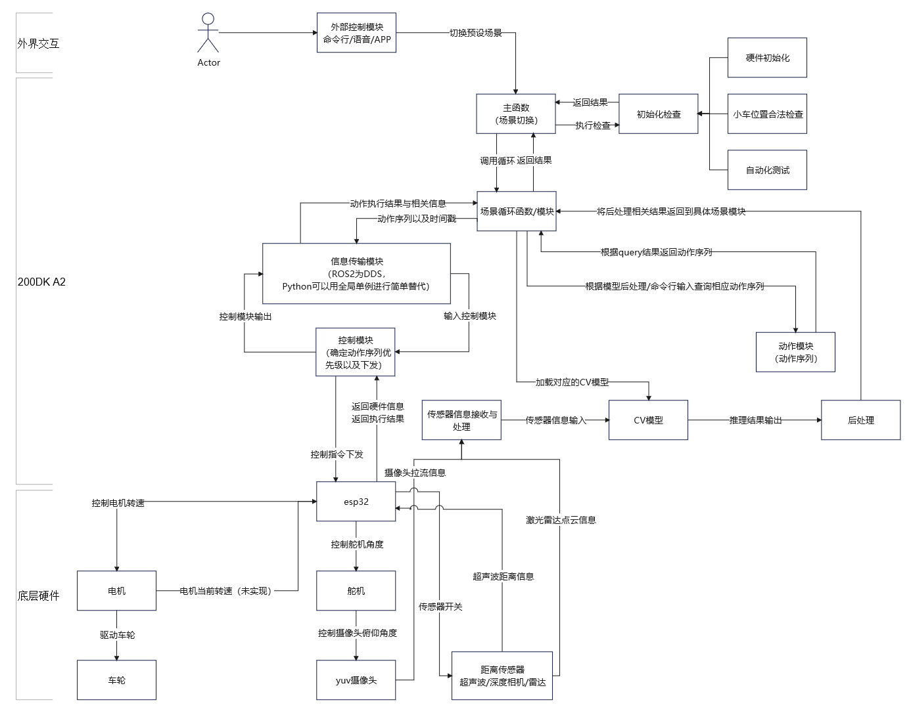

# Intelligent Robot Car E2E Sample Demo

English | [简体中文](README_zh.md)


## 1. Functions and Operating Principles
The robot car uses a camera to perceive its surroundings and control motion autonomously. Environmental data is processed by AI inference on the developer kit, and the results determine motion commands. An ESP32 microcontroller controls the chassis, with embedded development on the Arduino platform. Commands and feedback pass bidirectionally between the main controller and the chassis through a serial protocol.
The robot-car workflow spans the following tasks, from hardware to AI applications:
- Understand the vehicle components and their operating principles.
- Implement Arduino-based hardware control.
- Define the serial communication protocol.
- Design the main ESP32 firmware.
- Develop the command-communication interface between the developer kit and ESP32.
- Develop AI inference applications.

The main operating principles are illustrated below:


The component-coordination diagram is shown below:


### 1.1 Hardware

[Mechanical components for the robot car](https://ascend-repo.obs.cn-east-2.myhuaweicloud.com/Atlas%20200I%20DK%20A2/DevKit/samples/23.0.RC1/e2e-samples/Car/E2E%E6%99%BA%E8%83%BD%E5%B0%8F%E8%BD%A6%E6%A0%B7%E4%BE%8B3D%E7%BB%93%E6%9E%84%E4%BB%B6.zip)


Follow the intelligent-car application guide to prepare and assemble the hardware. This code assumes a vehicle assembled with the standard configuration.

### 1.2 Code


The project includes low-level chassis control, simple and complex motions, utilities and multiple inference models. The directory layout is shown below:

```
Car
├── python
│   ├── main.py   # Vehicle demo main entry point
│   ├── requirements.txt # Vehicle demo dependencies
│   ├── src
│   │   ├── Lane-Follow-Train # Lane-following training code
│   │   ├── det_label_spilt # Auxiliary detection classification model
│   │   ├── actions
│   │   │   ├── base_action.py # Basic vehicle motion
│   │   │   ├── complex_actions.py # Complex vehicle motion
│   │   │   └── __init__.py
│   │   ├── models
│   │   │   ├── bsae_model.py # Base model
│   │   │   ├── det_cls.py # Detection classification model
│   │   │   ├── __init__.py
│   │   │   ├── lfnet.py # Inference
│   │   │   └── yolov5.py # YOLOv5 detection model
│   │   ├── scenes  # Preset smart-vehicle scenes
│   │   │   ├── base_scene.py 
│   │   │   ├── command.py
│   │   │   ├── helper.py
│   │   │   ├── __init__.py
│   │   │   ├── lane_following.py
│   │   │   ├── manual.py
│   │   │   └── tracking.py
│   │   └── utils # Python utilities
│   │       ├── acl_utils.py
│   │       ├── camera_broadcaster.py
│   │       ├── common_utils.py
│   │       ├── constant.py
│   │       ├── controller.py
│   │       ├── cv_utils.py
│   │       ├── __init__.py
│   │       ├── init_utils.py
│   │       └── logger.py
│   └── weights # Model weights
└── 基于ESP32的智能小车控制
    ├── car_ctrl_esp32.ino
```

## 2. Run Procedure

### 2.1 Prepare the Runtime

Download the system image required to run the car:

[System image](https://ascend-repo.obs.cn-east-2.myhuaweicloud.com/Atlas%20200I%20DK%20A2/DevKit/images/23.0.RC1/1.1.0/A200I-DK-A2_e2e-samples-image_1.1.0_ubuntu22.04-aarch64.img.zip)
### 2.2 Run the Manual-Control Sample

Upload the code to the onboard developer kit, then enter the vehicle's working directory:
```
cd /home/python

```
Install the runtime dependencies:
```
pip install -r requirements.txt
```

Run the manual-control entry point:
```
python3 main.py
```
Use the keyboard to control movement:
| Key | Action |
|----|-----------|
| w | Forward |
| a | Backward |
| s | Turn left |
| d | Turn right |
| q | Rotate counterclockwise |
| e | Rotate clockwise |
| ↑ | Accelerate |
| ↓ | Decelerate |
| c | Capture the current camera image |
| space | Temporary stop |

### 2.2 Run the Autonomous-Driving and Parking Sample
```
cd /home/python
```

Run the autonomous-driving entry point:
```
python3 main.py -mode==cmd
```
Enter the following command:
```
Helper
```
This loads the turning and parking assistance model.

Then enter:
```
LF
```
This loads the straight-line correction model and starts autonomous driving. The car parks automatically after reaching a parking marker.

**Note: if lighting prevents the lane-following model from performing as expected, follow the instructions in /Car/src/Lane-Follow-Train to label and extend the dataset. Train the model with the supplied training code; its ONNX output is written to ./output. Use the atc conversion command below:**
```
atc --model=./lfnet.onnx --framework=5 --output=./out/lfnet --soc_version=Ascend310B1
```
**Convert the model to OM, then place ./out/lfnet.om in Car/python/weights, replacing the existing lane-following OM model if necessary.**

**Note: to recognize a different parking marker, build the detection model with the [developer-kit model adaptation tool](https://ascend-repo.obs.cn-east-2.myhuaweicloud.com/Atlas%20200I%20DK%20A2/DevKit/tools/23.0.RC1/1.1.3/Ascend-devkit-model-adapter_1.1.3_win-x86_64.exe), then follow det_label_split to build the auxiliary classification model and convert it to OM.**

### 2.3 Run the Object-Tracking Sample
```
cd /home/python
```

Run the autonomous-driving entry point:
```
python3 main.py -mode==cmd
```
Enter the following command:
```
Tracking
```
The car enters tracking mode.

**Note: to retrain for different parking markers or tracking targets, create an object-detection application with the [developer-kit model adaptation tool](https://ascend-repo.obs.cn-east-2.myhuaweicloud.com/Atlas%20200I%20DK%20A2/DevKit/tools/23.0.RC1/1.1.3/Ascend-devkit-model-adapter_1.1.3_win-x86_64.exe). Name the parking detection and classification models 'yolo.om' and 'cls.om' and place them in Car/python/weights. For tracking, name the detection model 'tracking.om' and replace its counterpart in Car/python/weights.**


